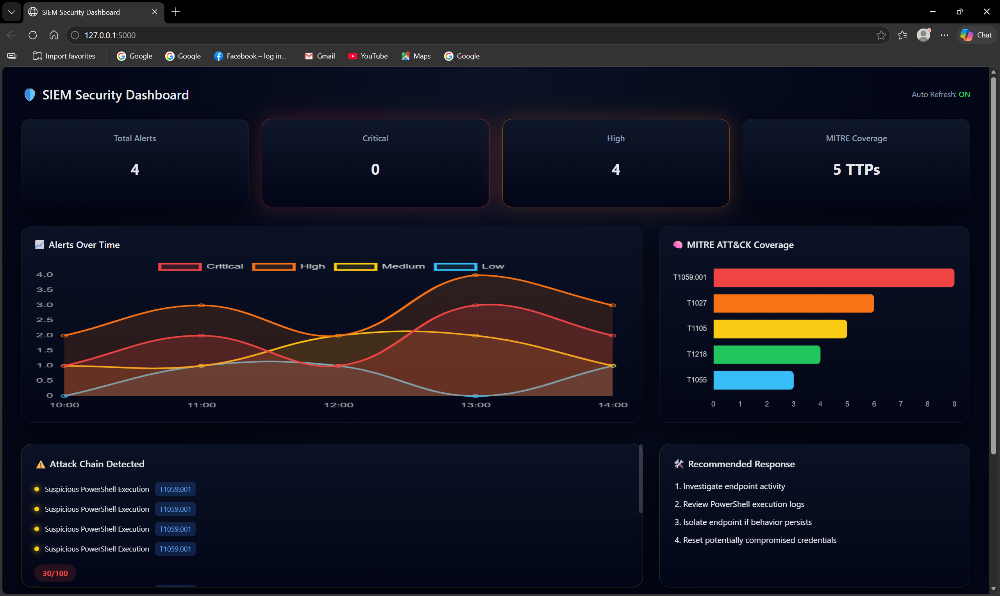
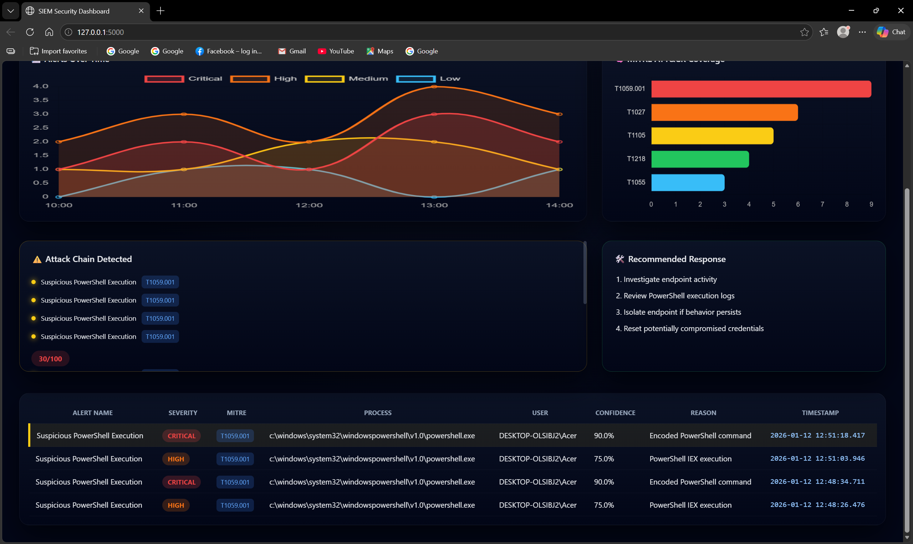

# Sysmon SIEM Homelab

A Windows endpoint-monitoring lab built with Python, Sysmon and Flask. It explores how process-creation telemetry can be turned into higher-signal PowerShell detections, structured alerts and an investigation dashboard.



## What this project does

The lab reads Windows Sysmon process-creation events (Event ID 1), inspects PowerShell command lines for suspicious indicators, and produces structured alerts for review.

The current implementation includes:

- **Event collection** — reads the `Microsoft-Windows-Sysmon/Operational` channel.
- **Rule-based detection** — looks for indicators including encoded PowerShell, `FromBase64String`, `Invoke-Expression` / `IEX`, and `DownloadString`.
- **Alert enrichment** — attaches severity, a confidence value, a short detection rationale and the MITRE ATT&CK technique identifier `T1059.001`.
- **Noise reduction** — deduplicates matches by command line in the Sysmon agent.
- **Basic correlation** — groups alerts that share a host and user within a ten-minute window.
- **Investigation view** — a Flask dashboard presents alert details, severity summaries and visualisations.

## Screenshots

| Dashboard | Alert view |
| --- | --- |
|  |  |

## Detection logic

The primary Sysmon agent currently applies keyword-based checks to PowerShell process command lines.

| Indicator | Current alert rationale |
| --- | --- |
| `-enc` | Encoded PowerShell command |
| `FromBase64String` | Base64 decoding detected |
| `IEX` / `Invoke-Expression` | Dynamic expression execution |
| `DownloadString` | Remote payload download |

These are useful starting points for a lab, not definitive indicators of compromise. Legitimate administration can use some of the same commands; detections need contextual analysis and tuning.

## How the pieces fit together

```text
Windows endpoint
      |
      v
Sysmon Event ID 1
      |
      v
Python event reader
      |
      v
PowerShell indicator rules
      |
      v
Structured JSON alerts
      |
      +----> Alert correlation
      |
      v
Flask investigation dashboard
```

## Technology

- Python
- Windows Sysmon and Windows Event Log APIs
- pywin32 and XML parsing
- Flask
- HTML, CSS and Chart.js
- MITRE ATT&CK technique references

## Project structure

| File | Responsibility |
| --- | --- |
| `agent_sysmon_ps.py` | Reads Sysmon process events and applies PowerShell checks |
| `detector.py` | Contains a separate event-level PowerShell detection function |
| `sysmon_reader.py` | Reads and parses Sysmon Event ID 1 records |
| `generate_alerts.py` | Generates structured alerts from collected events |
| `alert_store.py` | Loads persisted alert data |
| `attack_chain.py` | Groups related alerts by host, user and time |
| `attack_classifier.py` | Assigns rule-based attack categories and a heuristic score |
| `app.py` | Flask dashboard route and view data |
| `dashboard.html`, `style.css` | Dashboard interface |
| `alerts.json` | Sample/persisted alert data |

## Current status and limitations

This repository is a learning and experimentation project, not a production SIEM or endpoint security product.

A few implementation details still need to be reconciled before a clean installation can be documented:

- The Flask application imports modules from a `siem_engine` package, while the visible Python files currently sit at the repository root.
- The Flask view expects a `templates/` directory, and the HTML references a `static/` stylesheet path; those paths are not present in the current root listing.
- There is no dependency manifest yet, so a reproducible environment setup is not documented.
- The dashboard includes fixed example chart values and fallback sample alerts; those should not be interpreted as live telemetry.
- The detection rules are keyword-based and require broader testing, tuning and false-positive measurement.

For those reasons, setup and deployment instructions are intentionally not presented as verified commands.

## Next engineering steps

1. Reconcile the Python package, template and static-file layout.
2. Add a pinned dependency manifest and a repeatable setup procedure.
3. Add representative, sanitised event fixtures and automated tests for each detection rule.
4. Separate demo data from collected telemetry in the dashboard.
5. Record a reproducible evaluation before making claims about detection accuracy or noise reduction.

## Author

**Varun Gupta**  
[GitHub profile](https://github.com/varung4067-hash)

---

Built as a hands-on exploration of endpoint telemetry, detection engineering and SOC investigation workflows.
